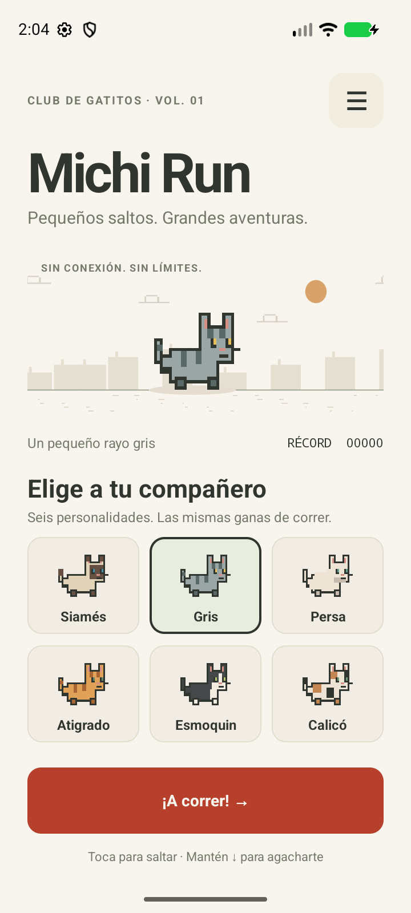
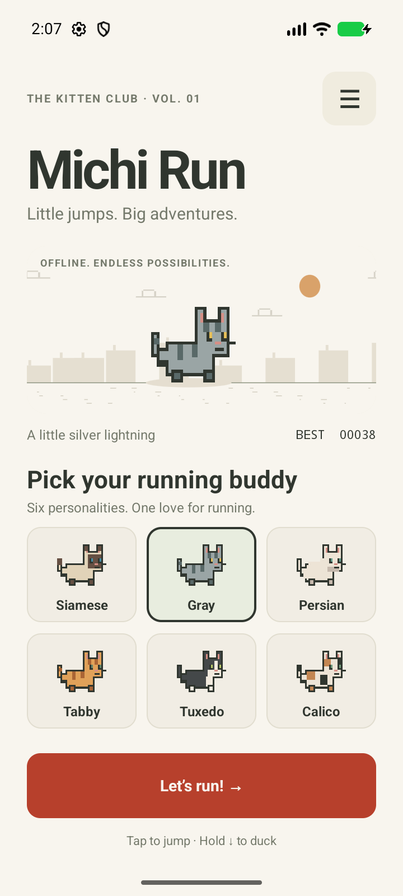
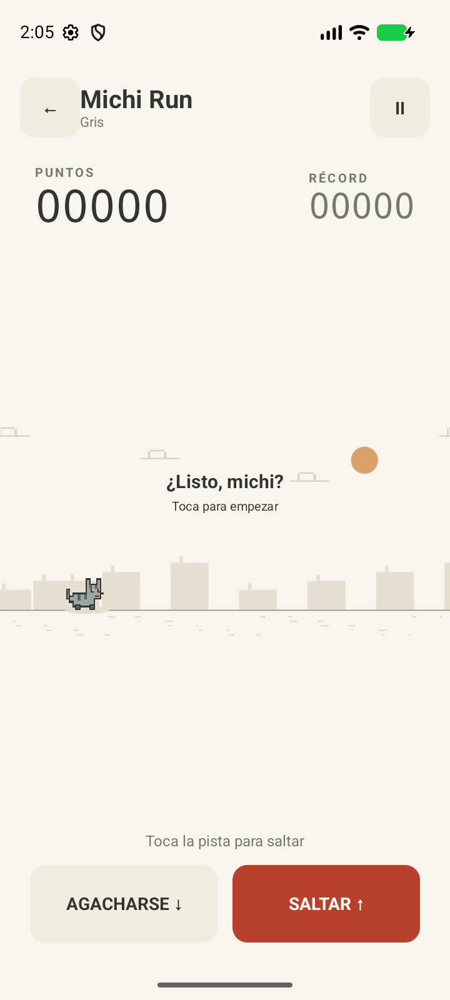

# Michi Run 🐾

Un juego Android de carreras infinitas, hecho en **Kotlin**: tu gatito corre, salta cactus y se agacha para esquivar pájaros. Inspirado en la mecánica del dinosaurio de Chrome, con gráficos de píxeles originales y una identidad propia.

| Español | English | Pista |
| --- | --- | --- |
|  |  |  |

## Qué incluye

- Seis gatitos disponibles desde el principio: siamés, gris, persa, atigrado, esmoquin y calicó.
- Selector de compañero con vista previa. Todos tienen la misma física.
- Saltos de altura variable, agacharse, colisiones y dificultad progresiva.
- Ciclo de día y noche, pausa, reintento y récord local.
- Español por defecto, inglés y opción de seguir el idioma del dispositivo desde **Ajustes → Idioma**. Si el dispositivo usa otro idioma, el texto se muestra en español.
- Sonidos opcionales, botones accesibles y soporte para teclado.
- Juego completamente offline: no solicita permiso de internet, no usa cuentas, publicidad ni servicios externos.
- Proyecto nativo con Activity, Views y Canvas. La lógica, los gráficos y las pantallas están en Kotlin; los textos y el manifiesto usan recursos XML de Android.

## Abrir en Android Studio

1. Clona [Kr0us/michi-run](https://github.com/Kr0us/michi-run) o abre la carpeta local **Mi primer proyecto** desde **File → Open**. Selecciona la carpeta que contiene `settings.gradle.kts`.
2. Espera la sincronización de Gradle. Para esta primera sincronización necesitas internet.
3. En **SDK Manager**, instala **Android SDK Platform 35** y **Build-Tools 35.0.0** si faltan.
4. Usa el **JDK incluido en Android Studio** en **Settings → Build, Execution, Deployment → Build Tools → Gradle → Gradle JDK**. El proyecto requiere Java 17 o una versión compatible; también se ha compilado con el JDK 21 incluido en Android Studio.
5. Selecciona un emulador o teléfono con **Android 8.0 (API 26)** o posterior y pulsa **Run ▶** con la configuración del módulo `app`.

Android Studio configura la ubicación del SDK en `local.properties`. Ese archivo pertenece a tu máquina y está excluido de Git.

## Compilar desde PowerShell

Si `JAVA_HOME` todavía no está definido, puedes usar el Java que trae Android Studio en una instalación habitual de Windows:

```powershell
$env:JAVA_HOME = 'C:\Program Files\Android\Android Studio\jbr'
.\gradlew.bat testDebugUnitTest lintDebug assembleDebug
```

En macOS o Linux:

```bash
bash ./gradlew testDebugUnitTest lintDebug assembleDebug
```

El APK de prueba se genera en `app/build/outputs/apk/debug/app-debug.apk`. Este APK es para pruebas; una publicación en Google Play requiere preparar una firma de lanzamiento propia.

Versiones fijadas para reproducir la compilación: **AGP 8.13.2**, **Gradle 8.13**, **Kotlin 2.2.10**, compile/target SDK **35**. Consulta la [compatibilidad oficial de AGP](https://developer.android.com/build/releases/agp-8-13-0-release-notes).

## Controles

| Acción | Pantalla táctil | Teclado |
| --- | --- | --- |
| Empezar y saltar | Toca la pista o SALTAR | Espacio o ↑ |
| Salto alto | Mantén pulsado | Mantén Espacio o ↑ |
| Salto corto | Suelta pronto | Suelta Espacio o ↑ |
| Agacharse | Mantén AGACHARSE | Mantén ↓ |
| Pausar | Botón Ⅱ o Atrás | Botón de pausa |

Para evitar un pájaro bajo, agáchate. Los cactus se esquivan saltando. Los pájaros más altos también pueden evitarse permaneciendo en el suelo. Al salir de la aplicación o girar la pantalla, la partida queda en pausa y puedes continuarla. Si Android elimina el proceso, recuperarla depende de que el sistema conserve el estado de la actividad; el récord, idioma, sonido y gatito se guardan por separado.

Con un lector de pantalla, los botones pueden activarse mediante clic de accesibilidad; AGACHARSE alterna entre agacharse y levantarse. La pista sigue siendo un juego visual de reacción y no ofrece un modo de navegación por audio.

## Organización del proyecto

```text
app/src/main/
├── java/com/kr0us/michirun/
│   ├── MainActivity.kt           # Pantallas, idioma, ajustes y persistencia
│   ├── game/
│   │   ├── CatBreed.kt           # Apariencia de los seis gatitos
│   │   └── RunnerEngine.kt       # Física, obstáculos y estado de la partida
│   └── ui/
│       ├── ActionButton.kt       # Pulsación mantenida y clic accesible
│       ├── CatPainter.kt         # Sprites originales dibujados en Kotlin
│       ├── CatPreviewView.kt     # Vista previa del gatito
│       ├── RunnerView.kt         # Renderizado y controles de la pista
│       └── Scenery.kt            # Paisaje, día y noche
├── res/values/strings.xml        # Español
├── res/values-en/strings.xml     # Inglés
└── AndroidManifest.xml
app/src/test/                    # Pruebas del motor
docs/VALIDACION.md                # Comprobaciones de esta versión
.github/workflows/android.yml    # Validación y APK en GitHub Actions
```

## Guardar los próximos cambios en GitHub

```powershell
git add .
git commit -m "Describe el cambio realizado"
git push origin main
```

Para `git push`, inicia sesión con tu cuenta de GitHub mediante Git Credential Manager o usa Android Studio. No pegues contraseñas ni tokens en el código. `local.properties`, cachés, claves de firma y archivos de compilación están excluidos.

En cada push a `main`, GitHub Actions ejecuta las pruebas del motor, Android Lint y la compilación. Al terminar correctamente, el APK se encuentra en **Actions → Android → ejecución → Artifacts → michi-run-debug**, disponible durante 14 días.

## Alcance de esta versión

Esta versión es una base jugable para Android. Los datos se guardan solo en el dispositivo; no incluye sincronización en la nube, compras, clasificación online ni publicación en tiendas. No requiere conectarse a GitHub para jugar.
